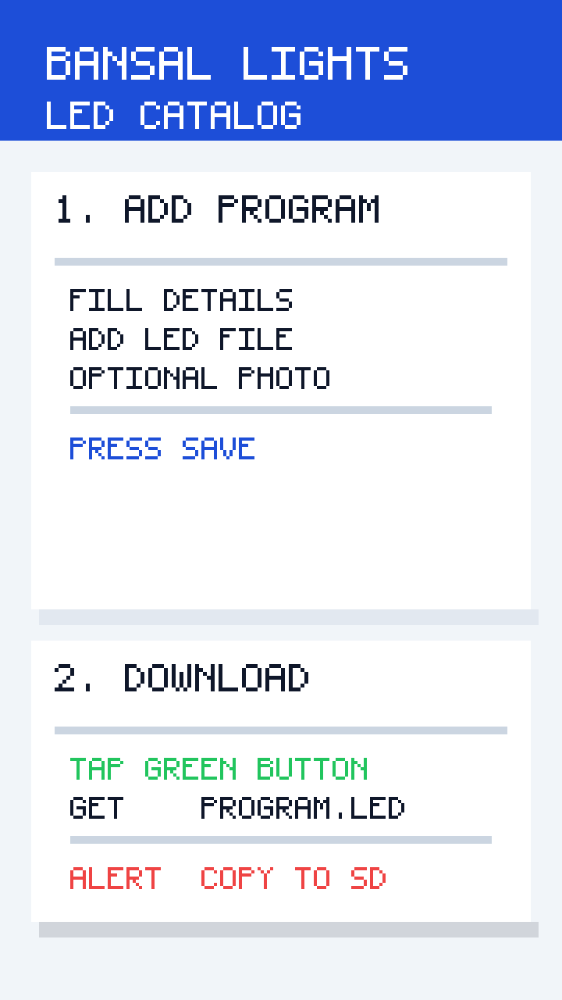

# Bansal Lights LED Catalog

Modern LED-program catalog for the Bansal Lights team. The app stores `.led` controller files in a folder you pick, and product photos and bilingual notes in the browser, so technicians can manage their library from a phone even when offline. Production deployments are served via the Cloudflare Pages project `led-catalog` (default domain: `https://led-catalog.pages.dev/`, swap for your custom domain as needed).



## Start here: paste this to your agent

```text
Set up the Bansal Lights LED Catalog (https://github.com/abhibansal60/led-catalog) for me.
1. Check my Node.js and npm versions with read-only commands. It needs Node 20 or newer.
2. Clone the repo (or run `git pull` if I already have it), then run `npm ci`.
3. Read AGENTS.md and the docs it points to before you change anything.
4. Run `npm test` and `npm run build`, and tell me what passed.
5. Start `npm run dev` and give me the URL. Open it in desktop Chrome or Edge: adding,
   downloading and copying programs all need the File System Access folder picker.
Ask me before you change any config, secrets or Cloudflare settings. Never push to
main: a push to main deploys straight to production, so work on a branch and open a PR.
```

## What You Get
- 📱 **Mobile-first interface** with large bilingual (English | हिंदी) labels and emoji cues.
- 💾 **Offline catalog**: program records live in IndexedDB and the `.led` files in a folder you pick. Each export also sends the program list (photos and notes included) to `/api/sync`; see [Operational Notes](#operational-notes).
- 💳 **Format & Copy to SD Card**: wipes the card, writes `00_program.led`, and checks the copy byte for byte. **Verify SD Card** re-checks a card later.
- 📥 **One-tap download** that always saves `00_program.led` for T-1000/T-8000 controllers, to copy to a card by hand.
- 🌐 **Browser support**: everything that touches `.led` files (add, download, SD card, full export and import) needs the File System Access folder picker, so use desktop Chrome or Edge. Without it the app shows "Browser unsupported".
- 📦 **Export and import**: a full backup (folder with the `.led` files plus `catalog.json`) or a JSON-only backup. Full import reads a full-backup folder; metadata import reads a JSON file and restores records without `.led` files.
- 📷 **Optional photo & notes** to identify how a program looks on-site.
- 🔐 **Reset switch** (hidden button) to wipe stored data if a device is being handed over.
- 🚀 **CI-backed deployment** to Cloudflare Pages on every push/merge to `main`.

## Tech Stack
| Area | Choice | Notes |
| ---- | ------ | ----- |
| UI | React 18 + TypeScript | SPA bootstrapped with Vite |
| Styling | Tailwind CSS + shadcn-inspired primitives | Custom component variants live in `src/components/ui` |
| State | React hooks + IndexedDB + File System Access API | `/api/sync` Pages Function stores the last export's metadata in Workers KV |
| Tooling | Vite 5 | Handles dev server and bundling; it transpiles TypeScript without typechecking |
| Tests | `node:test` + Playwright | Unit tests for `src/lib`, end-to-end specs in `e2e/` |
| Hosting | Cloudflare Pages (free tier) | Deployed by GitHub Actions workflow `deploy.yaml` with `wrangler pages deploy` |

## Local Development
1. Install Node.js 24 (what CI uses), and npm.
2. Clone the repo and install the locked dependencies:
   ```bash
   git clone https://github.com/abhibansal60/led-catalog.git
   cd led-catalog
   npm ci
   ```
3. Start the dev server:
   ```bash
   npm run dev
   ```
4. Open the printed URL (default `http://localhost:5173`) in desktop Chrome or Edge; the app's file features use the File System Access API. Changes hot-reload automatically.
5. Generate a production bundle in `dist/` and serve it locally:
   ```bash
   npm run build
   npm run preview
   ```

`npm run dev` does not run the `/api/sync` Pages Function, so the sync step of an export fails locally and the export itself still completes.

| Script | What it does |
| ------ | ------------ |
| `npm run dev` | Vite dev server with hot reload |
| `npm run build` | Production bundle in `dist/` (no typecheck) |
| `npm run preview` | Serves `dist/` locally |
| `npm test` | Unit tests for the `src/lib` helpers |
| `npm run test:e2e` | Playwright end-to-end specs in `e2e/` (run `npx playwright install --with-deps chromium` once first, as CI does) |

## Deployment
### Production
- Hosted on Cloudflare Pages at `https://led-catalog.pages.dev/` (or your custom domain).
- Build command: `npm run build`
- Output directory: `dist` (`pages_build_output_dir` in `wrangler.toml`)
- `functions/api/sync.ts` deploys as a Pages Function, bound to the Workers KV namespace `CATALOG_DB` declared in `wrangler.toml`.
- SPA routing handled automatically by Cloudflare Pages.

### Continuous Deployment (GitHub Actions → Cloudflare Pages)
Workflow file: `.github/workflows/deploy.yaml`

1. Create a Cloudflare API token with the **Cloudflare Pages: Edit** and **Workers KV Storage: Read/Write** permissions.
2. In the GitHub repository, add secrets:
   - `CLOUDFLARE_API_TOKEN`: the token created above.
   - `CLOUDFLARE_ACCOUNT_ID`: the account ID for the Cloudflare tenant hosting the project.
3. Merge a PR to `main`. The workflow:
   - Checks out the repo and installs dependencies with `npm ci` (Node 24).
   - Stamps the footer version: `VITE_APP_VERSION` (`ddmmyy-01`, the UTC build date). `vite.config.ts` adds the build time and the commit (`GITHUB_SHA`); the workflow's own `VITE_BUILD_TIMESTAMP` is overridden by it.
   - Builds the production bundle.
   - Publishes `dist/` with `cloudflare/wrangler-action@v4` (`wrangler pages deploy dist --project-name=led-catalog --branch=<branch>`).
4. Every pull request also runs the workflow and publishes a preview deploy under the PR's branch name. PRs from forks get no secrets, so their deploy step fails.
5. Monitor the Actions tab for the “Deploy to Cloudflare Pages” job. A green run equals a successful release.

A second workflow, `.github/workflows/test.yaml` (“Tests”), runs `npm test` and the Playwright suite on every PR and push to `main`.

## Testing & Quality
- `npm test` runs unit tests for the `src/lib` helpers (LED header check, file writes, SD card wipe).
- `npm run test:e2e` runs the Playwright specs in `e2e/` against the dev server: adding a program, export, import, and SD card copy and verify. `e2e/fake-file-system.ts` stands in for the folder pickers.
- Manual QA checklist (for what a real phone and SD card catch):
  - [ ] Add a program with all fields (file, photo, notes).
  - [ ] Add a program with only required fields.
  - [ ] Refresh the page and confirm saved programs persist.
  - [ ] Download button produces `00_program.led`.
  - [ ] Format & Copy to SD Card leaves only `00_program.led` (and its note) on the card, and Verify reports a match.
  - [ ] Delete confirmation works.
  - [ ] Hidden `Reset` button clears all data.
  - [ ] App behaves correctly on Android (portrait) and desktop.
  - [ ] Install as PWA and launch offline.
- Watch the browser console logs for “✅/❌” messages when debugging.

## Step-by-Step Tutorial (for Dad)
These friendly steps walk through the common job: adding a fresh LED program, copying it to an SD card, and double-checking that everything worked. Keep this page open on your phone or print it out for quick help.

### A. Add a new program in the app
1. **Open the LED Catalog app** on your phone or computer. If you use it as a shortcut on your home screen, tap that icon.
2. **Press “Add Program”.** A clean form will appear.
3. **Name the program.** Type something simple that you will remember, like “Diwali Gate 2024”.
4. **Pick the `.led` file.** Tap “Choose File”, then select the program file you received from the designer or copied from another device.
5. _(Optional)_ **Add a photo or note.** A quick picture of the installed lights or a short message like “Use on Panel A” helps later.
6. **Save.** Tap “Save Program”. You will see the new card appear on the home screen.

### B. Copy the program to an SD card
Use Chrome or Edge on a computer; other browsers show “Browser unsupported”.

**Straight to the card:** tap **“Format & Copy to SD Card”** on the program card and pick the SD card. The app first asks before it deletes everything on the card, then copies `00_program.led` and checks it. When it says the copy matches, go to step C4.

**Or download and copy by hand:**
1. **Insert the SD card** from the T-series controller into your phone (with an adapter) or a computer.
2. **Tap the “Download” button** on the new program card. The app always names the file `00_program.led`, which the controller expects.
3. **Choose the SD card as the destination.** On a phone, select “Files” → SD card. On a computer, save to the drive letter that matches the SD card.
4. **Wait for the copy to finish.** The app shows “File downloaded! Copy it to SD card.” when the file is saved.

### C. Check that everything worked
1. **Open the SD card folder** in your Files app or File Explorer.
2. **Confirm the file name.** Make sure `00_program.led` is listed. If another version already existed, delete the old one so only the fresh file remains.
3. **Look at the file size.** It should not be zero bytes. If it shows `0 KB`, copy the file again.
4. **Safely remove the SD card.** Use “Eject” on a computer or “Unmount” on a phone before pulling the card out.
5. **Test on the controller.** Insert the SD card into the LED controller, power it on, and press “Play”. The lights should follow the new pattern. If not, repeat the download and copy steps.

> Quick reminder: the app keeps all saved programs inside the device. If you clear the browser data or switch phones, restore them with **Import** from a full backup.

## File Layout
```
.
├── .github/workflows/
│   ├── deploy.yaml             # Build and publish to Cloudflare Pages
│   └── test.yaml               # Unit and Playwright tests on PRs and main
├── docs/
│   ├── agents/                 # Agent runbooks (deploy, issues, triage, domain)
│   ├── led-format-research.md  # What is known about the .led file format
│   ├── setup-ledit-windows.ps1 # Windows setup script for the LedEdit tool
│   └── screenshot.png          # README image
├── e2e/                        # Playwright specs + in-memory File System Access fake
├── functions/api/sync.ts       # Pages Function: keeps the last export in Workers KV
├── public/
│   ├── manifest.json           # PWA metadata (name, colors, icons)
│   └── service-worker.js       # Caches static assets for offline support
├── src/
│   ├── App.tsx                 # Core catalog experience
│   ├── components/ui           # Button/Card/Input/Label/Textarea primitives
│   ├── index.css               # Tailwind base layers + custom theme tokens
│   ├── lib/                    # storage (IndexedDB), ledFile, writeFileToHandle,
│   │                           # clearDirectoryContents, version, utils
│   ├── types/                  # File System Access API declarations
│   └── main.tsx                # Vite bootstrap + service worker registration
├── test/                       # node:test unit tests for src/lib
├── AGENTS.md                   # Start here for coding agents
├── CODING_STANDARDS.md         # Conventions for code and tests
├── tailwind.config.js          # Tailwind theme and shadcn tokens
├── vite.config.ts              # Vite config + build-time version stamp
└── wrangler.toml               # Pages project name, output dir, KV binding
```

## Operational Notes
- Program records live in the browser (IndexedDB) and `.led` files in the picked folder. Clearing browser data or switching devices requires export/import.
- Every export POSTs the program list, photos and notes included, to `/api/sync`, which keeps only the latest one in Workers KV under `latest-catalog`. A GET on `/api/sync` returns it without sign-in, and the POST has no check either, so treat that copy as public (decision pending in issue #34).
- Rotate the Cloudflare API token on a regular cadence and update the GitHub secret.
- Monitor Cloudflare Pages analytics (bandwidth/requests) monthly to ensure the project stays within the free tier.
- Update this README, `AGENTS.md` and `docs/agents/deploy.md` whenever automation or operating practices change.

## Contingency: Rebuilding the Cloudflare Pages Project
If the Cloudflare Pages project is deleted or the token expires, follow these steps to restore automated deploys:

1. **Back up the current production bundle**
   - Run `npm run build` locally to regenerate `dist/`.
   - Archive the output for safekeeping (attach to a GitHub Release if desired).
2. **Create a fresh Cloudflare Pages project**
   - GitHub Actions uploads the build itself, so create a Direct Upload project rather than a Git-connected one: `npx wrangler pages project create led-catalog --production-branch=main`.
   - If the KV namespace is gone too, create both (`npx wrangler kv namespace create CATALOG_DB` and the same with `--preview`) and put their ids in `wrangler.toml` (`id` and `preview_id`).
3. **Provision a new API token**
   - Generate a token with **Cloudflare Pages: Edit** and **Workers KV Storage: Read/Write** permissions.
   - Update the `CLOUDFLARE_API_TOKEN` and `CLOUDFLARE_ACCOUNT_ID` secrets in GitHub.
4. **Trigger the pipeline**
   - Push an empty commit or retrigger the latest workflow run from the Actions tab.
   - Confirm the deployment succeeds and the production domain serves the latest build.

> Tip: To deploy by hand, build with the version stamp (`VITE_APP_VERSION=$(date -u +%d%m%y)-01 npm run build`; without it the footer shows the stale `appVersion` from `package.json`) and run `npx wrangler pages deploy dist --project-name=led-catalog`. Without `--branch`, it publishes your current git branch, so run it from `main` for production.

## License
MIT – tailor it freely for the Bansal Lights team.
